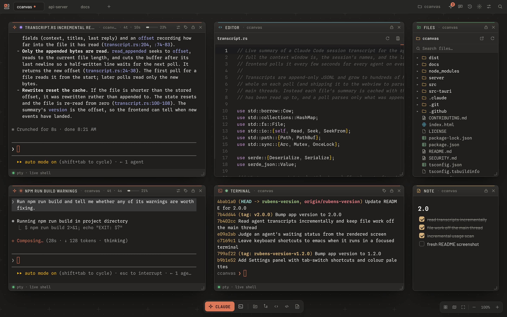
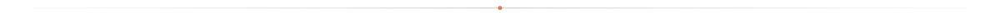

<div align="center">



<p></p>

[](https://github.com/DevoidSloth/ccanvas/releases/tag/v2.2.0)
[](https://tauri.app)
[](#stack)
[](src-tauri)
[](#quick-start)
[](LICENSE)

*Excalidraw, but the boxes are real terminals, Claude agents, and editors.*

Spawn shells, Claude agents, editors, and VS Code onto a boundless dark
surface, then arrange them the way you'd sketch a whiteboard. Every tab is a
self-contained `.ccnvs` workspace you can save, reopen, and share.

**[Download ccanvas 2.2.0](https://github.com/DevoidSloth/ccanvas/releases/tag/v2.2.0)** for macOS, Windows, and Linux · [What's new](#whats-new-in-22)

</div>

<p align="center">
  
</p>
<p align="center">
  <sub>Two Claude agents — one just finished, one mid-build — beside an editor, a file tree, a terminal, and a note.</sub>
</p>



## Why

A terminal multiplexer gives you panes; ccanvas gives you *space*. Lay out a
fleet of agents the way you'd sketch them on a whiteboard, watch each one's
status at a glance, and see how full each one's context is. When the canvas
gets crowded, the **agent roster**, **canvas search**, the **tab finder**, and
a **tracking camera** that orbits an agent's files keep you oriented.

This branch trims the toolbox down to what actually gets used driving
Claude day to day — agents, terminals, files, diffs, and editors — and
spends that space on making each of those sharper: a real VS Code, terminal
fidelity that matches your own shell, and drag‑and‑drop straight into a
running agent.

## What's new in 2.2

| | |
| --- | --- |
| 🔄 **Updates itself** | The desktop app checks for new releases on launch and every few hours, downloads them in the background, and offers *Restart to update* when one is ready. It never restarts on its own, since that would end running terminals |

## What's new in 2.1

| | |
| --- | --- |
| 🤖 **Codex agents** | Settings → Agents picks which CLI new agents launch: Claude Code or OpenAI's Codex. Each agent remembers its CLI, so existing agents and older canvases keep opening Claude |
| 💾 **Canvases live in their folder** | A canvas bound to a folder autosaves to `<folder>/<name>.ccnvs` as you work, and choosing that folder again reopens it, or switches to the tab that already has it open |
| 🌐 **Links open on the canvas** | Double-click a link in a terminal or agent to open it in a web widget beside it; ⌘/Ctrl-click opens it in your browser |

## What's new in 2.0

| | |
| --- | --- |
| ⚡ **Fast with many agents** | Scrolling, typing, switching tabs, and clicking stay responsive with lots of tabs and agents open. Each agent's session transcript is now read a little at a time as it grows, instead of in full every few seconds, and file reads, `git`, and the usage scan no longer hold up the window |
| ⌨️ **Emacs keeps its keys** | When emacs is running in the focused terminal, shortcuts like `⌃X ⌃F` go to emacs instead of ccanvas |
| 💬 **A more accurate waiting dot** | An agent shows as waiting only when Claude is actually asking you something, such as a permission prompt or a choice menu, not when a reply merely ends with a question |

**Also new since 1.0**

| | |
| --- | --- |
| 🎨 **Settings and colour palettes** | A Settings panel (the gear in the top bar, or `⌘,` on macOS) with six palettes — Claude, Ember, Moss, Slate, Plum, and Mono — a text size (Default to Larger) that scales text in widgets, terminals and panels without resizing anything, and the keys that open the tab finder |
| 🔎 **Tab finder** | `⌃X ⌃F` opens a bar at the bottom of the window to jump to any tab by name, with Tab completion. Vim keys (`:`, `gt`, `gT`) or a shortcut of your own can be switched on in Settings |
| 🗂️ **Tabs you can arrange** | Drag tabs to reorder them; a crowded strip squeezes its tabs before it scrolls and keeps the active one in view |
| 🟣 **A just-finished dot** | An agent's dot turns purple for two minutes after it finishes a turn, in its title bar, the roster, and its zoomed-out card |
| 📂 **Path autocomplete in the editor** | The editor's file box lists matching files and folders as you type: arrows to move, Tab to complete, Enter to open |

## What this branch adds

| | |
| --- | --- |
| 🖥️ **VS Code, embedded** | `⌘⇧V` opens the real VS Code (`code serve-web`) as a widget, scoped to the canvas folder, with extensions from Open VSX — no separate window to manage. Needs the `code` CLI on PATH (VS Code → *Shell Command: Install 'code' command*); works in both the desktop app and the browser build |
| 🖼️ **Drag & drop into agents** | Drag a file — an image, a screenshot, anything — from Finder/Explorer straight onto a terminal or agent widget; it's pasted in as a path Claude Code reads as an attachment. The widget outlines while you're hovering over it. Desktop app only |
| 🎨 **Your terminal, not a generic one** | On macOS, terminal widgets pick up your default iTerm2 profile — font, cursor, ANSI palette — so a ccanvas terminal looks like the one you already live in; anything it can't read falls back to the built-in theme, as does every other platform today |
| 🧠 **Memory panel** | A side dock renders Claude's own cross-session memory for the bound folder as a force-directed graph — nodes, links, and types, read straight from `~/.claude/projects/…/memory/` each time you open it |
| 🔢 **Hold ⌘ to see terminal numbers** | Hold `⌘` for a beat and every terminal shows the digit that `⌘1`–`⌘9` jumps to; let go and they're gone again |
| 🪞 **Desktop sessions, mirrored** | The **Desktop sessions** panel lists the chats you're running in the Claude desktop app (Code tab); pick some, or *Add all running*, and each becomes a read-only, live-following transcript on the canvas, with a context meter and a row in the Agents roster. Right-click a mirror → *Fork into terminal* to branch it. macOS desktop app only; it reads the desktop app's internal session files |
| 🗂️ **Layers** | A tab can hold a stack of layers, and each layer can be its own project, with its own folder and its own view. Press `L` and the canvas tilts back into a stack of every layer; click one to dive in. Agents on hidden layers keep running. See [Layers](#layers) |
| 📛 **Agent titles that stay in sync** | A Claude agent widget adopts the name you `/rename` inside the session, or the title Claude generates after the first prompt, instead of sitting at "claude agent" forever |
| 🎵 **Now playing** | A small player for whatever the Spotify app (or Apple Music) is playing: artwork, track and artist, a seek bar, play/pause, previous and next, shuffle and repeat, the app's own volume and mute, and the favourite in Music. Click the artwork to open the app; when both have a track, the source label switches between them. With the widget active, `←`/`→` skip 5 seconds, `Space` plays or pauses and `↑`/`↓` set the volume. It fits any size, from a thin strip to a big focus-mode layout. `Space` → `music` (or `spotify`), or *Now playing* in the palette. It reads the apps over AppleScript, never opens one that isn't running, and polls only while the widget is on screen. The first time, macOS asks whether ccanvas may control Spotify; if you said no, allow it under System Settings → Privacy & Security → Automation. Nothing about what you're playing is saved with the canvas. macOS desktop app only for now |
| 🪶 **A slimmer toolbar** | Fewer buttons, same power — the vector-drawing tools and GitHub-issue widgets from upstream are gone from the chrome; the surface is just Claude, a shell, and the files between them |


## Quick start

### Download

Prebuilt installers for **2.2.0** are on the
[release page](https://github.com/DevoidSloth/ccanvas/releases/tag/v2.2.0):

| Platform | File |
| --- | --- |
| macOS (Apple silicon and Intel) | `ccanvas_2.2.0_universal.dmg` |
| Windows | `ccanvas_2.2.0_x64-setup.exe` or `ccanvas_2.2.0_x64_en-US.msi` |
| Linux | `ccanvas_2.2.0_amd64.AppImage`, `.deb`, or `ccanvas-2.2.0-1.x86_64.rpm` |

**Opening it on macOS:** the app isn't notarized (that needs a paid Apple
Developer account), so Gatekeeper will flag it as being from an unidentified
developer the first time you open it. Either right-click `ccanvas.app` →
*Open* → confirm *Open* in the dialog, or strip the quarantine flag from the
Terminal:

```bash
xattr -cr /Applications/ccanvas.app
```

You only need to do this once per download.

**Updates:** from 2.2.0 on, the desktop app checks for new releases on launch
(and every few hours), downloads them in the background, and offers *Restart
to update* once one is ready. Versions before 2.2.0 need one manual install.

### Build the desktop app (Tauri)

```bash
npm install
npm run app        # dev: launches the native window
npm run app:build  # build an installer → src-tauri/target/release/bundle
npm run app:install  # macOS: build just the .app and replace /Applications/ccanvas.app
```

The desktop build is the real thing: native folder/file dialogs, native file
IO, and an **in-process PTY** per terminal, a real shell with no separate server
and no WebSocket hop. Requires the Rust toolchain (`rustup`) and, on Windows,
the WebView2 runtime (preinstalled on Windows 11).

### Web app

```bash
npm run dev        # → http://127.0.0.1:5173
```

In the browser the canvas can't reach the filesystem on its own, so real
terminals + folders come from an optional local backend (run it in a second
terminal, or `npm start` to run both at once):

```bash
npm run server     # ws + http on 127.0.0.1:7531 (web preview proxy on :7532)
npm start          # runs the pty server and the web app together
```

The backend can run programs and read and write files, so it only answers the
app itself: requests from any other origin are refused, and every route needs a
token that changes each launch and is only handed to the app's origin. If you
serve the web app from somewhere other than `127.0.0.1:5173` or
`localhost:5173`, list that origin in `CCANVAS_ORIGINS` (comma-separated), e.g.
`CCANVAS_ORIGINS=http://localhost:3000 npm run server`.

The backend gives the browser what the sandbox can't: a real shell per terminal
widget (via `node-pty`; prebuilt binaries ship for Windows/macOS) and a native
folder picker + file IO. Each **canvas is bound to a folder**: creating a new
canvas asks where to put its `.ccnvs`, and that folder becomes the working
directory every terminal/agent opens in. A **Claude agent** widget is just a
real terminal in the canvas folder with `claude` already running.

Terminal widgets auto-connect and fall back to a small in-browser shell when the
backend isn't running; the footer pill shows `pty` (live) or `local`
(fallback). Without the backend you can still bind a folder by typing a path.
File drag-and-drop needs the desktop app; the VS Code widget works here too.


## What's in here

| Surface | Notes |
| --- | --- |
| **Infinite canvas** | Pan by dragging empty canvas, middle-dragging, or scrolling with two fingers; smooth zoom with ⌘/Ctrl-scroll or a pinch; dot grid; minimap (toggle it in the bottom-right controls) |
| **Quick insert** | `Space` opens a command box at the cursor: type a widget name (`agent` `term` `files` `diff` `editor` `note` `web` `music`), optionally followed by an agent's first prompt, a file path, an address, or a note's text |
| **Command palette** | ⌘/Ctrl-K to spawn widgets, arrange, switch tabs, open panels, insert prompts, run git, export, or jump to a widget |
| **Widgets** | Claude agent · Terminal · File tree · Git panel · Editor (Monaco) · **VS Code** · Markdown note · **Web page** · Now playing (macOS), plus the Transcript (right-click an agent) and data, figure, and video viewers that open from the file tree or a path clicked in a terminal |
| **Drag & drop** | Drop a file from the OS onto a terminal or agent to paste its path in — the way you'd hand Claude a screenshot |
| **Agent orchestration** | Per-agent status dot (idle, working, waiting, just finished), an *N waiting* inbox, idle notifications, broadcast to many, per-agent model/prompt/flags, and colour labels you can filter the canvas by |
| **Context meter** | Each agent's bar shows how full its context window is (read from its session transcript), with a one-click **compact** past 70% |
| **Plan usage** | The top-bar pill shows Claude's own session and weekly limit % with reset times, using your Claude Code sign-in (desktop app); falls back to a local token estimate. Its popover also estimates what the canvas's agents and mirrors would cost at API prices |
| **Memory panel** | Claude's cross-session memory for the bound folder, rendered as a graph you can pan, zoom, and click into |
| **Agent roster** | Mission-control list of every agent across all tabs: status, cost/turns, latest reply, click-to-focus, and a composer to message one or broadcast to all |
| **Tracking camera** | Follow an agent and watch every file it touches spawn as a viewer in an **orbit** around it, arrows pointing back; the camera stays framed on the action |
| **Transcript widget** | An agent's *real* conversation rendered from its session JSONL: clean text + tool chips, free of terminal box-drawing chrome, following the session live |
| **Checkpoints** | Git-backed working-tree snapshots: save a point before letting an agent loose, restore tracked files if it makes a mess |
| **Prompt library** | Reusable prompt snippets you can insert into the focused agent, drag onto any agent, or manage; persisted like layout templates |
| **Canvas search** | ⌘/Ctrl-F to search every element's text (titles, notes, paths, URLs, prompts, frame names) and jump to it |
| **Follow active agent** | A headless camera mode that pans to whichever agent most recently started working |
| **Settings** | Six colour palettes, text size, and the keys that open the tab finder (Emacs on by default; Vim and your own shortcuts are opt-in) |
| **Arrange** | Group, lock, align, distribute, tidy, copy/paste/duplicate, z-order, snapping guides; arrange terminals by label colour or by folder |
| **Right-click menus** | Canvas elements (duplicate, copy, lock, group, z-order, delete), agents (track, open transcript, label), file-tree rows (open in the editor or a viewer, open with the default app, **reveal in Explorer/Finder**, copy path), tabs (pin, rename, close), empty canvas (paste, select all, reveal folder) |
| **Layers** | A stack of planes per tab, each optionally its own project folder with its own view; `L` opens a tilted overview of every layer with live agent status, and hidden layers keep running |
| **Tabs** | Multiple `.ccnvs` workspaces open at once, each bound to its own folder; drag to reorder, pin the ones you keep, jump with the tab finder |
| **Persistence** | Save/Open into the canvas folder (backend) or File System Access API; reusable widget-layout templates; PNG/SVG export |


## Web pages

A **web** widget (quick insert `web`, alias `browser` `url` `site`; the
command palette's *New: Web page*; or type an address into the palette) shows a
page under a browser-style bar: back, forward, reload, a rounded address field
(the site's icon, its host and then the rest of the path, with a thin line
along the bottom while a page loads), a local `.html` file (live-reloads on
save) and ↗ to open it in your browser. Type an address (`example.com`,
`localhost:3000`, `3000`, an IP, `./index.html`) to go there; anything else
searches Google.
- **Its card shows the site.** Zoomed out, in the layers overview and in its
  title bar, a web widget shows the icon of the page it's on now (YouTube's,
  GitHub's…), fetched from the site itself (never a third-party icon service)
  and cached per site. Now playing shows Spotify's or Music's icon, VS Code
  its own, Claude chats and agents Claude's, and the GitHub widgets GitHub's
  mark, each still ringed by its status (working, needs you, done).

- **On the canvas it's a preview.** Local dev servers (`localhost:5173`) embed
  directly. Other sites load through a small proxy that strips the headers that
  stop them being framed, so they show, but without your cookies or logins and
  with some pages half-working. A quiet *preview* tag in the bar says so.
- **Focus it (⌘⇧↵) for the real browser** (desktop app). The address bar moves
  into the focus strip and a native webview fills everything under it: logins, scripts and everything else work, and every
  web widget shares one profile, so you stay signed in. Links stay in the view;
  a link that opens a new window opens it in a new web widget beside this one
  and focuses that. ⌘⇧↵ inside the page goes back to the canvas, and the widget
  keeps the page you were on (only the URL is saved in the `.ccnvs`).
- Being native, that view is drawn above the page, so it hides while a menu, the
  command palette or anything else is over it, and it only exists in focus
  mode, where nothing moves. In the browser build, focus mode shows the preview
  with a note instead.

- **Sign-ins stay.** Every web widget's browser shares one persistent store
  of its own (macOS 14+), apart from the app, so signing in once keeps you
  signed in across widgets and relaunches. *Settings → Web sign-ins → Sign out of all
  sites* clears it.

Safety: the native view gets no access to ccanvas (no Tauri IPC or
permissions, http(s) only, never the app's own origin). The preview proxy runs
on its own loopback port (built into the desktop app; `npm run server` provides
it for the browser build) and refuses local and private-network addresses, so a
proxied page can't reach anything on your machine. The desktop app's also checks
what a name resolves to and where each redirect goes.


## Watching agents work

The canvas is great for layout but poor at *"is anything stuck?"*, so these
three features are the answer at scale:

- **Agent roster** (the **Agents** button in the top bar, or command palette →
  *Agent roster*): every agent across every tab in one list, with live status,
  cost and turn count, and its latest reply. Click a row to fly the camera to
  that agent; type in the composer to message one agent or broadcast to all.
- **Tracking camera** (right-click an agent → *Track this agent*): as the agent
  reads and writes files, each one opens as a viewer widget arranged in an orbit
  around it with a dashed arrow pointing back (`read` arrows are labelled). The
  camera reframes to keep the agent and its satellites in view. Stop keeps the
  files; **Stop & clear** removes the orbit. Driven entirely by the agent's
  session transcript, so it sees the real tool calls.
- **Follow the active agent** (command palette → *Follow the active agent*): a
  lightweight mode that just pans to whichever agent most recently started
  working. It stands down while the tracking camera is active.

### Mirroring Claude desktop-app sessions

If you run Claude Code chats in the Claude desktop app, you can watch them on
the canvas alongside your own agents. Open **Desktop sessions** (the monitor
button beside **Agents** in the top bar, or command palette → *Desktop
sessions*). It lists every session the desktop app knows about, newest first,
with its folder, model and a dot that pulses while the session is running (its
transcript was written in the last 30 seconds). Filter by title, folder or
model; archived sessions are hidden unless you untick *hide archived*. Tick
some and press **Add**, or press **Add all running**. Each becomes a mirror
on the active canvas (sessions already mirrored there are skipped).

A mirror is a transcript widget with a **Desktop** badge. It follows the
session live, picks up renames, and shows its context fill, both on the widget
and in the Agents roster. It is **read-only**: there is no composer and no
compact button, and ccanvas never runs `claude --resume` on a mirrored session,
because a second writer would split the desktop app's transcript. To take a
session somewhere else, right-click the mirror → **Fork into terminal**. That
opens a terminal in the session's folder running
`claude --resume <id> --fork-session`, which continues from a copy under a new
session id. Mirrors save with the workspace; if a session's transcript is gone
when you reopen, the mirror says so.

To reply, answer a question or approve a tool, use the arrow button in the
mirror's title bar (or right-click → **Open in Claude app**). It opens that
exact chat in the desktop app. When Claude asks you something, the mirror and
its roster row show **Needs you**, and the question and its options appear
under the transcript. When a tool call has had no result for 10 seconds, a
**Bash?**-style chip appears: it is waiting for your approval or still
running, and the transcript can't tell which.

Every transcript widget (mirrors and your own agents' transcripts) also has:

- **Cost**: `≈$12.40` in the bar is what the session's tokens would cost at
  Claude API list prices (hover for each model's share). On a subscription
  it's an API-equivalent estimate, not a bill. The usage pill's popover adds
  up every agent and mirror on the canvas.
- **Files changed**: the `✎ 15` chip lists the files the session's Edit and
  Write calls changed, newest first. Click one to open it beside the
  transcript, or open the git panel for the session's folder.
- **Prompt jumps**: `⌃` / `⌄` (or ⌥↑ / ⌥↓ with the transcript focused) move
  between the prompts you typed.
- **Copy**: the `⋯` menu copies the last reply, or the chat as Markdown. For a
  transcript too large to load whole, it offers to read the full file once.
- **Subagent work**: open a Task row and press *Show the subagent's work* to
  read that subagent's own log inside it. It's loaded only then, followed
  only while it's shown, and dropped when you hide it.

This reads the desktop app's internal, undocumented session files
(`~/Library/Application Support/Claude/claude-code-sessions/`). It works only
in the macOS desktop build, and a change to that format would break discovery
(all of that parsing lives in `src-tauri/src/desktop_sessions.rs`).

## Layers

A tab can hold a stack of **layers**. Use them to keep several projects, or
several groups of agents, on one canvas without them crowding each other.

- **Make one.** Right-click empty canvas → *New layer…*, press `N` in the
  overview, or right-click a widget → *Move to new layer…*. Each opens the
  same folder picker as the folder chip: the layer becomes that project, named
  after the folder. Cancel the picker for a plain layer in the tab's folder.
- **Each layer is its own project.** New terminals, agents, file trees, git
  panels and editors open in the layer's folder (falling back to the tab's).
  The folder chip shows and sets the current layer's folder when it has one,
  and each layer remembers its own view, so switching returns you to where
  you were.
- **Switch.** Press `L` (or `⌃⌘↑` from anywhere, even inside a terminal) to
  open the layers overview: each widget dims to a tile where it stands (its
  title bar doesn't change), then the canvas settles back into an accordion of
  every layer around the one you're on, which faces you while the rest fold
  into thin slats above and below it, higher layers higher up. As it
  settles, the tiles' text fades in down the sheet. Hover,
  scroll or press `↑` / `↓` to roll the accordion through the stack, then
  click a sheet or slat, press `⏎`, or press its digit to dive in: the text
  fades out, the sheet eases flat onto the canvas, its name
  glides into the layer chip, and its tiles, landed as cards, crossfade into
  the live widgets. `Esc` or `L` goes back the same way,
  and `L` turns the move around at any point, so tapping it quickly goes in
  and out from wherever it is. `⌥↑` / `⌥↓` and `⌥1`–`⌥9` switch
  instantly.
- **See what's where.** Each sheet draws its widgets as tiles where they sit.
  The open sheet's tiles show the status icon (a spinner while an agent
  works, amber when it needs you, a check when it's just done), a two-line
  name, the widget's type and its last line; `V` switches them to a few
  lines of each widget. Slats show just coloured blocks (working tinted,
  waiting amber), and a layer with an agent waiting on you gets an amber
  edge. Text only ever shows on a sheet that's nearly flat, so it's never
  skewed. The rail names every layer on one line, and the open one on two,
  with its folder and how many agents are working or need you. The layer
  chip shows an amber dot when an agent on another layer is waiting on you.
- **Find across layers.** `/` in the overview filters every sheet as you type
  (title, type, path, folder, URL); the rail says where the matches are, and
  `⏎` dives to the first one with it selected.
- **Move widgets.** Drag a tile onto another sheet or its label in the rail,
  right-click → *Move to 02 · name*, or press `⇧⌥↑` / `⇧⌥↓` to send the
  selection a layer up or down (you stay where you are). A widget keeps its
  position and its folder (a running terminal can't change directory); the
  overview marks it with its home folder.
- **Arrange the stack.** In the overview, `⇧↑` / `⇧↓` move the open layer
  up or down, `R` renames it, and `del` removes it: its widgets merge into the
  layer below, and nothing closes (a layer with widgets asks twice; `⌘Z` puts
  them back on a layer of their own). The base layer stays.
- **Desktop mirrors sort themselves.** *Add* in the Desktop sessions panel puts
  each mirror on the layer whose folder holds that session's folder, and on
  the current layer otherwise.
- **Nothing stops.** Widgets on hidden layers stay mounted, so their agents,
  shells and mirrors keep running and the roster, attention inbox and search
  still see them. Clicking one of those jumps to its layer first. Switching
  layers always drops keyboard focus, so typing never reaches a terminal you
  can't see, and `⌘1`–`⌘9`, `⌘W` and `⌘A` act on the current layer only.
- **Saved in the canvas file.** One `.ccnvs` holds every layer. A canvas with
  a single layer saves exactly as before. An older build opens a layered file
  with everything on one plane, but saving it there drops the layers' names,
  folders and cameras.

The right-click menu on the layer chip (`≡ 02 WEBAPP`, shown once a tab has two
layers) adds a layer, sets or clears its folder, and renames it.

The overview is mounted only while it's open. One number, the open
position, follows a spring and drives every sheet; only transforms and
opacity change, and its frame loop stops when the accordion is at rest. With
reduced motion it crossfades instead of flying. `npm test` runs the layer model's unit tests,
including the accordion's geometry.

## Safety net: checkpoints

Before turning an agent loose on your working tree, drop a **checkpoint**
(command palette → *Checkpoints*). Each one is a real git object created with
`git stash create` and pinned under `refs/ccanvas/cp/<id>` so gc never collects
it, and it snapshots tracked changes **without** touching your working tree or
the stash list. Restore is deliberately non-destructive: it resets tracked
content to the snapshot but never deletes files the agent created afterwards.
(Untracked files at checkpoint time aren't captured.) Requires the canvas folder
to be a git repo.


## Keyboard

On macOS the canvas shortcuts use ⌘ only, so Ctrl combinations reach your
terminal untouched; on Windows and Linux they use Ctrl.

| Key | Action |
| --- | --- |
| drag empty canvas / middle-drag / two-finger scroll | pan |
| `Shift`-drag | box-select |
| ⌘/Ctrl + scroll, or pinch | zoom to cursor |
| `Space` | command box at the cursor (`agent`, `term`, `files`, `diff`, `editor`, `note`) |
| ⌘/Ctrl + `K` | open / close the command palette |
| ⌘/Ctrl + `F` | search this canvas |
| `⌃X ⌃F` | tab finder (Vim `:` / `gt` / `gT` can be switched on in Settings) |
| ⌘ + `,` | Settings (macOS desktop app) |
| ⌘/Ctrl + `S` / `O` / `N` | save · open · new canvas |
| ⌘/Ctrl + `T` / `Shift T` | new terminal · new Claude agent |
| ⌘/Ctrl + `Shift V` | new VS Code widget for this canvas's folder |
| hold ⌘ | show the jump-number on every terminal |
| ⌘/Ctrl + `1`–`9` | jump to and focus the Nth terminal or agent on the current layer |
| ⌘/Ctrl + `Shift ]` / `[` | next · previous terminal |
| ⌘/Ctrl + `Esc` | leave the focused terminal |
| ⌘/Ctrl + `Shift ↵` · `F` | focus mode: the widget you're in (or the selected one) fills the window under a single bar (its name, controls and, for a web page, the address bar); again, `Esc`, or a click on the dimmed board to go back. While focused, ⌘1–9, ⌘⇧]/[ and the strip's numbers switch which widget is focused |
| `S` · `U` | stack the selected widgets · unstack the selected stack |
| `Space` · `⌥Space` | spread the selected stack · spread the stack you're typing in |
| `[` / `]` · ⌃`⇥` | switch a stack's front widget (⌃⇥ works inside it too) |
| ⌘/Ctrl + `W` | close the focused widget on the current layer (desktop app; quits when no tab has a widget left) |
| `L` · ⌃⌘`↑` | layers overview (`⌃⌘↑` works inside a terminal too) |
| `⌥↑` / `⌥↓` · `⌥1`–`⌥9` | layer up / down · jump to layer N |
| `⇧⌥↑` / `⇧⌥↓` | send the selection one layer up / down |
| in the overview: `↑` `↓` · `⏎` · `1`–`9` · `/` · `N` · `R` · `del` | move · dive in · jump · find · new layer · rename · remove |
| in the overview: `⇧↑` `⇧↓` · `V` · `Esc` | reorder · tiles/cards · back |
| ⌘/Ctrl + `Z` / `Shift Z` | undo · redo |
| ⌘/Ctrl + `C` / `X` / `V` / `D` | copy · cut · paste · duplicate |
| ⌘/Ctrl + `G` / `Shift G` | group · ungroup |
| ⌘/Ctrl + `L` | lock / unlock selection |
| ⌘/Ctrl + `[` / `]` | send to back / bring to front |
| ⌘/Ctrl + `A` | select all on the current layer |
| ⌘/Ctrl + `0` `+` `-` | 100% / zoom in / zoom out |
| `\` | zoom to the selection, or fit everything |
| `Delete` / `Backspace` | delete the selected drawings, text, frames and images (never a widget: close those with ✕ or Delete in the right-click menu) |
| `Esc` | clear the selection |
| drag · click | move a widget you haven't clicked into · click into it to use it |
| double-click | rename a widget or tab · edit text |

## Stack

Vite · React · TypeScript · Zustand · xterm.js · Monaco · **Tauri 2** (Rust). The
same frontend runs as a native desktop app or in the browser; native
capabilities sit behind a small abstraction that picks the best available
backend.

## Architecture notes

- **`src/store/workspace.ts`**: single Zustand store; the active workspace is the
  source of truth and what serializes to `.ccnvs`.
- **`src/canvas/`**: pointer/zoom state machine, SVG vector layer, inline text.
- **`src/widgets/`**: `WidgetFrame` chrome (drag/resize/z-order) plus per-type
  bodies (terminal, transcript, editor, `VsCodeBody`, diff, data, plot, …).
- **`src/lib/backend.ts`**: native dialog/file IO, choosing Tauri commands → HTTP
  bridge → graceful no-op by `isTauri()`.
- **`src/lib/terminal.ts`**: terminal transport, choosing in-process Tauri PTY →
  WebSocket bridge → in-browser fallback shell.
- **`src/lib/termProfile.ts`**: reads the user's own terminal look (font, cursor,
  palette) from the machine and feeds it to xterm as the widget's theme.
- **`src/lib/fileDrop.ts`**: listens for the OS drag-drop the webview otherwise
  swallows, finds the terminal/agent under the cursor, and pastes the dropped
  paths in as a bracketed paste.
- **`src/lib/transcript.ts`**: reads and parses Claude Code session JSONL (last
  turn for flow piping, touched files for the tracking camera, full conversation
  for the transcript widget), and runs one shared poller per agent that feeds
  its context meter, title sync, and roster entry.
- **`src/lib/tracker.ts`**: the tracking camera, which polls a transcript, spawns
  satellite viewers in an orbit, and keeps the camera framed.
- **`src/lib/checkpoints.ts`**: git-backed working-tree checkpoints.
- **`src/lib/settings.ts`** and **`src/ui/Minibuffer.tsx`**: colour palettes,
  tab-finder keys, and the tab finder itself.
- **`src-tauri/`**: the Rust app: `src/pty.rs` (a `portable-pty` shell per widget,
  streaming `pty:data`/`pty:exit` events), `src/transcript.rs` (per-agent
  transcript summaries that parse only what was appended since the last poll),
  `src/usage.rs` and `src/plan_usage.rs` (the usage pill), `src/editor.rs` (the
  VS Code `serve-web` process + local proxy), `src/web_proxy.rs` (the web
  widget's canvas preview), `src/native_view.rs` with `src/lib/nativeView.ts`
  (the real browser over a focused web widget), `src/term_profile.rs` (reads the
  host terminal's theme), and `src/files.rs` (native dialogs + fs; reads, `git`,
  and directory listings run off the main thread).
- **`server/pty-server.mjs`**: the optional web-mode backend (same protocol, over
  `ws`/`http`) for when you run in a plain browser.


<div align="center">
<sub>ccanvas 2.2.0 · See <a href="CONTRIBUTING.md">CONTRIBUTING.md</a> to hack on it · <a href="LICENSE">LICENSE</a></sub>
</div>
